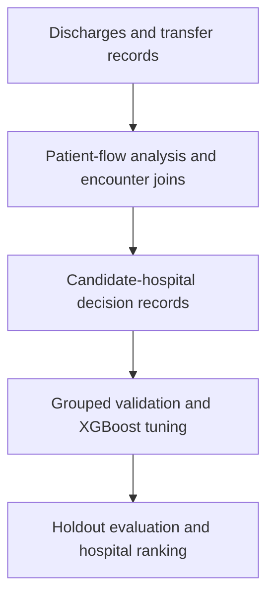

# Hospital Patient Flow and Transfer Ranking

**Python · pandas · scikit-learn · XGBoost · Predictive Analytics**

A machine-learning workflow that links discharge and transfer records, estimates candidate-hospital acceptance probabilities, and ranks hospitals for outreach. Exploratory analysis connects patient-flow trends with hospital-level transfer decisions.

## Project highlights

- Analyzed **1,324 linked discharge and transfer records** in the SickKids patient-flow project.
- Built a decision-level dataset combining patient context, hospital choice, transfer type, and temporal features.
- Compared logistic regression, random forest, histogram gradient boosting, and **XGBoost**, with encounter-grouped validation and hyperparameter tuning.
- Reported a **0.176 Brier score** and **38.6% acceptance capture within the top 30% of ranked decisions**, equivalent to approximately **1.29× lift** over random ordering.
- Developed an Excel dashboard for patient-flow trends; the notebooks provide the repository's executable analysis and visualizations.

These figures summarize the project analysis. The included data is **fully synthetic**, with fictional hospitals and generated identifiers, so anyone can run the workflow without confidential records. Scores from these files are separate demonstration results. See [evaluation methodology](docs/evaluation.md).

## Pipeline



The runnable workflow reserves 20% of encounters for testing, compares models within three grouped training folds, and searches eight XGBoost configurations. Preprocessing is fitted inside each fold. Model selection uses cross-validation Brier score; the test set is evaluated afterward.

Outputs include ROC-AUC, average precision, Brier score, capture and lift at 10%, 20%, and 30%, a cumulative capture curve, and a ranked hospital list for one synthetic case.

## Run locally

Use **Python 3.11 or 3.12**.

```bash
git clone https://github.com/russellmo945/hospital-transfer-ranking.git
cd hospital-transfer-ranking
python -m venv .venv
source .venv/bin/activate
# Windows PowerShell: .venv\Scripts\Activate.ps1
python -m pip install -r requirements.txt
python -m unittest discover -s tests -v
python run_pipeline.py
```

The synthetic CSV files are included. To regenerate the same dataset with seed 42:

```bash
python generate_synthetic_data.py
```

For an interactive walkthrough, run `jupyter notebook` and open:

1. [Patient-flow analysis](notebooks/Preliminary_Data_Analysis.ipynb)
2. [Modeling and hospital ranking](notebooks/Predictive_Model.ipynb)

Each notebook runs independently from the repository root or `notebooks/` directory. Run all cells in order. The command-line runner executes the same Python cells without a Jupyter server. On macOS, if XGBoost reports a missing `libomp` library, install it with `brew install libomp`.

## Generated outputs

| Location | Contents |
| --- | --- |
| `runs/modeling/model_comparison.csv` | Cross-validation and holdout metrics |
| `runs/modeling/metrics.json` | Split sizes, selected model, tuning settings, and metrics |
| `runs/modeling/capture_curve.svg` | Holdout capture curve |
| `runs/modeling/candidate_ranking.csv` | Ranked candidates for a synthetic encounter |

Generated outputs stay under the ignored `runs/` directory. Rerunning replaces these local outputs.

## Explore the implementation

| File | Purpose |
| --- | --- |
| [Data guide](docs/data.md) | Input columns, joins, and synthetic dataset structure |
| [Evaluation methodology](docs/evaluation.md) | Model selection, metric definitions, and interpretation |
| [Decision and metric helpers](transfer_ranking.py) | Strict outcome labels, validated joins, capture, and lift |
| [Synthetic generator](generate_synthetic_data.py) | Reproducible fictional encounters and transfer outcomes |
| [Notebook runner](run_pipeline.py) | Execute the complete workflow with the active Python environment |
| [Tests](tests/test_pipeline.py) | Identity, joins, labels, grouped splits, and metric checks |

## Scope and limitations

This is a retrospective operational analysis. Final length of stay and discharge timing may be unavailable when outreach begins; live use would require features measured at that decision time. Capture is calculated across pooled hospital decisions, not as a per-patient success rate. Bed capacity, staffing, and outcomes for uncontacted hospitals are not observed. Synthetic predictions demonstrate the software and are not suitable for patient-transfer decisions.
